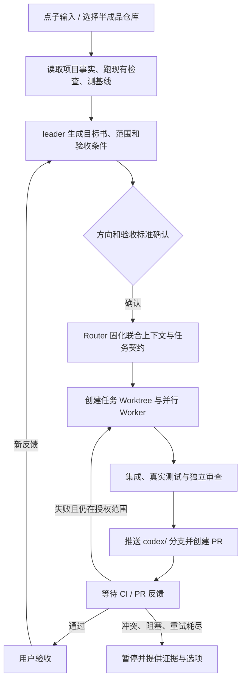

# 本机 Codex Idea-to-Delivery 架构

状态：单仓库本机 MVP 已实现；真实 GitHub/GitLab 远端闭环仍待验收。日期：2026-11-05。

## 目标

从一条新点子或一个未完成仓库出发，自动把工作推进到有证据、可审查的 PR；CI 失败时，在原任务范围和重试上限内继续修复。用户的注意力只用于方向裁决、验收、合并和发布等关键决定。

## 主流程

## 模块职责

| 模块 | 负责 | 不负责 |
| --- | --- | --- |
| Intake / CLI | 接收新点子或仓库路径；生成唯一任务号；保存原始输入 | 自行判定含糊需求已获批准 |
| leader Skill | 调研现状、补足目标书、明确边界与验收 | 调度后台任务、保管任务状态 |
| Router / Policy | 判断来源、仓库、触发类型和授权范围；组装联合任务上下文；把目标拆成边界清晰的 Worker 任务；把同一任务的后续 CI/评论直送原 Worker | 写产品代码；让事件正文改变命令、路径或权限 |
| Autoloop | 事件、状态、暂停/恢复、去重、通知、有限重试 | Codex 执行或项目验收 |
| Codex Router Session | 维护一个任务的目标、批准范围、状态与集成契约；按可并行性决定串行或并行；汇总子任务结果 | 直接承担所有实现细节；越过批准范围 |
| 专项 Worker | 在独立子会话中完成后端、前端、测试、修复等一个明确子任务；只接收完成该任务所需的上下文、边界和接口契约 | 对外向用户决策；扩大范围；覆盖其他 Worker 的文件 |
| Review / CI Worker | 用独立只读会话检查差异，范围内问题回到拥有该文件的 Worker；CI 事件按稳定 task ID 回到原 Router 并核验失败日志 | 修改验收标准来制造绿灯 |
| Skills | 按阶段提供方法：leader、hv-analysis、neat-freak、khazix-writer | 全链路调度；与任务无关的技能默认不调用 |
| 人 | 确认方向、产品判断、验收、合并/发布 | 重复转贴日志和催办继续 |

## 联合上下文和并行规则

批准后，Router 先生成一份不可变的 `task-context.json`：目标与非目标、批准的文件/行为边界、基线与当前提交、验收命令、风险、任务 ID、Worktree 路径和接口契约。JSON 结构以 `schemas/task-context.schema.json` 为准，并通过 `scripts/validate-task-context.mjs` 检查；校验器拒绝跨 Worker 重叠的文件白名单、越界路径、无效依赖和依赖循环。每个 Worker 获得任务包摘要，加上自己的子任务说明、允许触碰的文件范围、依赖和交付格式；不会收到整段无关聊天历史，也不能从事件正文取得命令、仓库路径或权限。

能拆成互不写同一文件的工作时（例如后端规则、前端 UI、测试设计），Router 并行派发最多 3 个 Worker；有依赖或共享文件时明确串行顺序，不能为并行而并行。集成由 Router 负责，只有在 Worker 返回变更和证据后才检查兼容性、运行全量验收。独立 Review 使用单独只读会话或只读审查 Worker，不由实现者自评代替。

独立审查与 CI 失败都先由 Router 处理。范围内且有明确归属的审查问题直接派回原 Worker 修复，整条流程继续；只有超出批准范围、验收冲突、需要用户身份/权限、修复耗尽或到合并/发布决策点时，Autoloop 才通知用户。CI 轮询事件按稳定任务 ID 续接 Router，附上失败提交、运行链接、日志和剩余修复次数；PR 评论事件尚未接入。Worker 只可在已批准范围内修复，最多两轮；第三次失败暂停并通知用户。

## 任务状态

`captured → investigating → awaiting_scope_approval → planned → working → checking → awaiting_ci → repairing → ready_for_review → accepted`。任意状态可进入 `blocked` 或 `cancelled`。所有状态变化记录来源事件、时间、Codex thread、工作树路径、当前提交、检查结果和尝试次数；恢复时先读取记录，不重做已完成阶段。

同任务的 CI / review 事件直达原 Worker（快路径）；新点子、仓库变更或无法关联的事件先过 Router 和规则判断（慢路径）。重复事件按 source + stable event id 去重。

## 权限与止损

- 当前 MVP 提供本地点子输入和单仓库路由；切换半成品项目时重配 `IDEA_REPO_PATH`。GitHub CI 使用 `gh run list`、GitLab CI 使用 `glab ci list` 定时轮询，不接 Issue/Webhook。
- Router 首轮只读；用户批准后才允许本任务 Worker 写入任务 Worktree。原始仓库、用户配置、凭据和其他项目只读；不把事件正文当作系统指令。
- 自动动作限于创建 Worktree、修改文件、运行已核实的检查、创建 `codex/<slug>` 分支、推送并开 PR。
- 不自动合并、发版、部署、删除数据或对外发消息。缺权限、认证、方向冲突或验收条件不明确时暂停。
- CI 自动修复最多 2 次；轮询按任务分支上不同失败提交计数，并在第三次失败事件上设置 `repairExhausted`，Router 不再派修复 Worker，只提供证据与选项。不会降低测试、跳过测试或改验收条件。
- 不以所有权隔离替代操作系统账号/容器隔离；单一 macOS 用户下的进程仍可能访问该用户可读的文件。

## 已核实能力和缺口

- 本机：macOS；Codex CLI `0.166.0-alpha.6`；系统默认 Node 保持 `v23.4.0`，项目脚本显式使用独立 Homebrew Node 24 `24.22.2_2`；GitHub CLI `2.87.3`。Autoloop 已装在本项目 `.local` 隔离目录，前台运行已实测，尚未安装为登录服务。实测于 2026-11-05。
- Autoloop 的官方 Codex 适配器能保存 thread id 并生成 `codex://threads/<id>` 链接；但实测 `codex exec --worktree` 不能用于 resume（CLI 返回“cannot resume an existing session”）。因此不能把该 flag 机械地加到每轮命令。
- Codex CLI 的 rollout JSONL 记录原生 `collaboration.spawn_agent` 与 `SubAgentActivity` 生命周期，包含子会话 ID、Worker 路径和状态。`scripts/codex-subagents.mjs <主会话 ID>` 从主会话日志提取这些字段，避免依赖 Router 自述。2026-11-05 的本机海战棋试点实测服务端、前端、测试和只读 reviewer 子会话，并核对了各自状态和子会话 ID。
- MVP 自定义 Router 首次收到事件时创建任务级 detached Git Worktree，以规则固定的原项目 `cwd` 作为 Git 仓库入口；Codex Router Session 从该 Worktree 启动。续接同一 thread 时回到同一路径，不使用 `--worktree`，获批后才创建 `codex/<任务编号>` 分支并提升到 workspace-write。版本化任务包约束任务范围、角色拆分、依赖和文件所有权。工作树复用、权限闸门、独立审查回流和多 Worker 并行均有自动化或实际运行证据。
- Agent-Autoloop 规则配置有固定 `cwd`，README 未声明动态 Worktree 管理；任务级 worker adapter 负责按不可变事件对象编号、安全创建与复用 Worktree。
- Autoloop 要求 Node 24。本机保留系统 Node 23.4.0，并用 Homebrew Node 24.22.2_2 启动本地中台和运行项目命令。
- DeepSeek 的 `dsh-superagent` 是研究原型。本工具采用 Router/Worker 分层、联合上下文、任务订阅直达和并行执行的设计；继续使用 Codex CLI 原生 multi-agent，不把 DeepSeek 原型误当成可直接安装的 Codex 插件。原文把 Router 定义为不执行具体任务的全局协调者，Worker 持有隔离上下文；任务可并行但需由 Router 集成并负责用户沟通。
- 海战棋试点 6/6 规则与 HTTP 测试通过，并在 `0.0.0.0:3000` 启动；两个独立浏览器客户端用 `127.0.0.1` 与 `localhost` 完成整局。尚未用第二台物理设备验收真实 LAN，也未推送或创建远端 PR。
- 发布器在临时 bare Git 远端实测 fetch、主分支祖先检查、任务分支 push 和模拟 GitHub PR 创建；GitLab 路径用模拟 `glab` 覆盖。真实 GitHub/GitLab 认证、PR/MR 与 CI 仍待有远端项目验收。
- CI 轮询逻辑测试覆盖等待所有工作流完成、失败提交去重、通过回执和两轮修复上限；试点无 GitHub 远端，因此没有真实 CI 事件回流验收。

## MVP 阶段

1. **已完成**：独立 Node 24 环境、Autoloop 本地路由、本地点子入口、Router 首轮只读规划与审批、批准后隔离 Worktree 写入、会话续接和稳定 task ID 反馈。
2. **已完成并实测**：联合上下文任务包、最多 3 个不重叠范围 Worker、真实 Codex 子 Agent 分派、Router 集成、只读独立审查和普通问题自动回流。
3. **已实现并本机验证**：任务分支发布器、现有 PR/MR 更新、GitHub/GitLab CI 轮询与 `repairExhausted` 边界；发布器以临时 bare Git 远端实测，CI 以集成测试覆盖。不会自动合并或部署。
4. **待真实外部验收**：使用已认证 GitHub 远端确认 PR 创建、CI 事件回流和两轮修复/耗尽后暂停；另需第二台物理设备验证海战棋 LAN。试点仓库没有远端，不能代替这些验证。

## 试点评估

先建立人工流程基线，再比较点子到 PR 用时、人工介入次数、首轮 CI 通过率、自动修复成功率、返工/回归问题。没有实测之前不设目标数字、不宣称效率提升。
